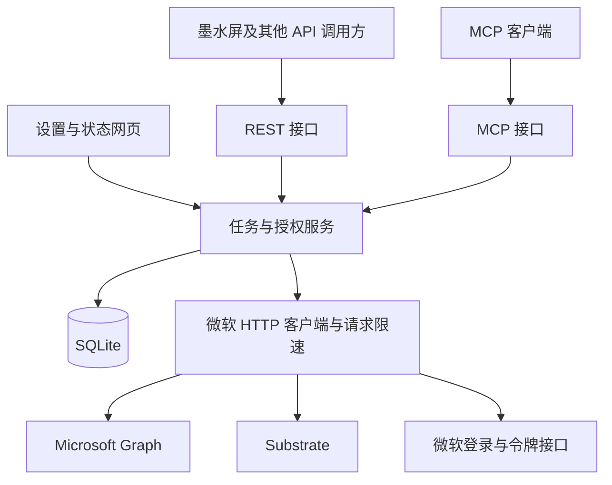

# Go 重写需求与实施计划

> 本文保留重写时的历史设计与旧代码映射。独立仓库已经把 Go 模块移至根目录；下文 `go/` 路径均指拆分前的位置。使用当前版本请参照 [README](../README.md) 和 [部署教程](go-setup.zh-CN.md)。

本项目将以单个 Go 服务和 SQLite 重写，优先向墨水屏提供完整、可靠的 Microsoft To Do 我的一天任务列表，并通过 REST 和 MCP 支持个人任务管理。部署采用 Docker Compose，数据按需更新，任务缓存有效期为 3 分钟。

设计基线为 **`ab2c186`**，需求确认日期为 **2026-10-24**。微软交互以此基线已经跑通的代码为主要依据，重点替换语言、部署和存储方式。现有两份资料继续作为行为和验收依据：

- [My Day 接口验证记录](./myday-feed-verification.zh-CN.md)
- [现有 REST API 契约](https://github.com/qaq112233/mstodo-cloudflare/blob/ab2c186/REST_API_GUIDE.zh-CN.md)

本文是实施设计，文中新增路由、配置和命令均为规划；现有 TypeScript 服务及上述资料保持原样。

## 已确认的需求

| 项目 | 决定 |
| --- | --- |
| 使用范围 | 单个用户、一个微软账号，主要服务墨水屏，兼顾后续 AI 管理任务 |
| 部署 | Docker 和 Docker Compose，持久化一个本地数据目录 |
| 核心接口 | 保留 `GET /api/v1/myday` 及现有成功响应字段 |
| My Day 数据 | 缓存为空或过期时实时读取微软；完整成功后缓存 180 秒 |
| 失败行为 | 缓存过期后读取失败，返回明确错误，由墨水屏保留上次成功画面 |
| 普通查询与搜索 | 查询时检查新鲜度，超过 180 秒才更新所需数据；空闲时不同步任务 |
| 任务管理 | 清单和任务增删改查、完成和恢复、正文、重要性、日期、提醒、重复规则、分类标签 |
| 其他首版功能 | 步骤管理、跨清单查询和搜索、My Day 加入和移出、跨清单移动、任务及步骤及 My Day 手动排序、关联链接管理 |
| MCP | 公网 Streamable HTTP，与 REST 共用业务逻辑和缓存 |
| 访问验证 | 可选无验证、静态 Bearer token、秘密路径；不实现面向 MCP 客户端的 OAuth 服务 |
| 初始化 | 首次打开简易设置网页，填写微软应用信息并授权，之后可查看连接状态 |
| 存储 | SQLite，包含设置、微软授权状态和可重建缓存 |
| 后续待办 | 附件上传下载 |

首版不迁移旧项目的清单分类规则、别名和自动链接规则。提醒和重复任务由微软执行；本服务负责读写对应字段，不自建提醒推送或日程引擎。

## 服务结构



一个进程负责 HTTP、MCP、授权、缓存和微软访问。REST 与 MCP 直接调用 Go 业务函数，不相互发 HTTP 请求。SQLite 是本地设置和缓存存储，微软仍是任务数据的最终来源。

技术选择如下：

| 用途 | 选择与理由 |
| --- | --- |
| HTTP 和网页 | 标准库 `net/http`、`html/template`、`embed`，页面随可执行文件发布 |
| 数据库 | 标准库 `database/sql` 配合 `modernc.org/sqlite`，直接写 SQL |
| MCP | 官方 `github.com/modelcontextprotocol/go-sdk`，不手写协议 |
| 微软请求 | 标准库 HTTP 客户端，参考旧代码的 URL、字段、请求头和错误处理 |
| 并发和限速 | 少量资源锁、重复请求合并，配合 `golang.org/x/sync` 和 `golang.org/x/time/rate` |
| 日志 | 标准库 `log/slog`，输出到容器标准输出 |

SQLite 驱动采用无 CGo 依赖的实现，方便发布 amd64 和 arm64 容器；MCP SDK 负责协议兼容。实际实施时锁定经过构建验证的依赖版本，不直接追随浮动版本。依据：[SQLite 驱动说明](https://pkg.go.dev/modernc.org/sqlite)、[官方 MCP Go SDK](https://github.com/modelcontextprotocol/go-sdk)。

不引入 Redis、外部数据库、消息队列、ORM、依赖注入框架、独立前端工程、多租户或多副本协调。

建议 Go 代码先放在独立的 `go/` 目录，便于与基线并排核对：

```text
go/
  cmd/mstodo/main.go
  internal/
    app/             服务启动与连接各模块
    httpapi/         REST 路由和访问验证
    mcpserver/       MCP 工具适配
    web/             设置网页和模板
    microsoft/       Graph 与 Substrate 客户端及令牌管理
    todo/            My Day、任务、步骤、移动、排序及查询
    store/           SQLite 和顺序执行的 SQL 迁移
  go.mod
  go.sum
  Dockerfile
  compose.yaml
  .env.example
```

这是代码组织，不为每个包建立额外接口层。只有确有替换或测试需要的 HTTP 发送、时钟等依赖才使用小接口。

## 现有代码参考映射

实施每项功能前，先阅读对应旧实现及其测试，再翻译微软请求和行为。Cloudflare 专用调度、KV、Durable Object 和 MCP 客户端授权服务不逐行移植。

| Go 版功能 | `ab2c186` 参考位置 | 保留和调整 |
| --- | --- | --- |
| My Day feed | `src/graph/substrate-client.ts` 的 `listMyDayTasks`；`src/cache/index-do.ts` 的 `getMyDayFresh` | 保留显式日期、Value 响应、分页、去重、整体期限和完整性判断 |
| My Day 返回格式 | `src/service/myday.ts`、`src/api/myday.ts` | 保留字段投影、完成状态、稳定排序及错误映射 |
| 微软授权 | `src/auth/microsoft.ts`、`src/auth/handler.ts` | 保留微软授权码和 PKCE、账号校验及 anchor mailbox 处理；移除与 MCP OAuth Provider 的耦合 |
| 令牌刷新 | `src/cache/index-do.ts` 的资源令牌刷新和 maintenance | 保留跨 Graph 与 Exchange 串行刷新、同资源请求合并及 refresh token 持久化 |
| 普通微软请求 | `src/graph/client.ts`、`src/graph/substrate-client.ts` | 保留主机限制、401 处理、分页和超时；去除 Workers 专用预算限制 |
| 清单与任务 CRUD | `src/mcp/agent.ts` 对应工具段、`src/graph/types.ts` | 抽出共享 Go 服务，覆盖现有字段及 PATCH 清空字段语义 |
| 步骤和关联链接 | `src/graph/todo-resources.ts`、`src/mcp/agent.ts` 对应工具段 | 复用已验证 URL 和字段，REST 与 MCP 使用同一实现 |
| My Day 写入 | `src/mcp/agent.ts` 的 `add_to_my_day` 和 `remove_from_my_day` | 加入时设置 CommittedDay、清 PostponedDay 并设置 CommittedOrder；移出沿用已验证请求 |
| 无损移动 | `src/graph/substrate-client.ts` 的 `reparentTask`、旧 `move_task` 主路径 | 保留原任务重挂清单和 ID 变化；首版移除复制后删除的降级分支 |
| 手动排序 | `src/mcp/reorder.ts`、`src/mcp/my-day-order.ts`、三个 reorder 工具 | 保留时间戳及中点算法、步骤读取写入方式；My Day 邻居改从直接 feed 获取 |
| 增量查询缓存 | `src/graph/delta.ts`、`src/cache/sql.ts`、`src/cache/migrations.ts` | 参考 delta 游标、删除标记和数据字段；改为按需更新 |
| 访问验证 | `src/api/auth.ts` | 保留 Bearer 比较，扩展 none 和 path 模式 |
| 回归案例 | `test/myday-feed.test.ts`、`test/fresh-myday.test.ts`、`test/api.test.ts`、`test/delta.test.ts`、`test/reorder.test.ts`、`test/my-day-order.test.ts`、`test/move-task.test.ts` | 将有意义的输入输出案例转为 Go 测试，不照搬 Cloudflare 测试基础设施 |

必须调整的一处现有差异：旧 MCP `list_my_day_tasks` 和 My Day 排序仍依赖按字段筛选的缓存，而 REST 已接入直接 feed。Go 版统一以直接 feed 确认成员，避免两套接口显示不同任务。

## My Day 接口与缓存

### 数据读取

继续读取已经验证的微软内部接口：

```http
GET https://substrate.office.com/todob2/api/v1/myDayFeed/sections/tasks?date=YYYY-MM-DD
```

日期默认按配置时区 `Asia/Shanghai` 计算，始终显式传给微软。feed 是成员依据，默认保留已完成任务；不按截止日期、CommittedDay 或 PostponedDay 二次推测成员，也不回退到全清单扫描。过去日期查询仅表示查询该日期的 feed，不承诺历史快照。

返回格式沿用现有 REST 契约中的 `date`、`timezone`、`count`、`tasks`，以及任务的 `id`、`listId`、`listName`、`title`、`status`、日期、提醒、categories 和 My Day 排序字段。`includeCompleted=false` 在完整 feed 上过滤。

排序仍按 `committedOrder` 降序、`orderDateTime` 降序，最后用清单 ID 和任务 ID 保持稳定。列表名称缺失返回 `null`，不删除对应任务。

清单元数据优先使用有效缓存；需要补充时最多占用 2 秒，失败时使用已有名称或 `null`。获取名称不等待全账号任务同步，不在 My Day 读取中删除共享清单或任务。

### 三分钟缓存规则

缓存单位是“账号、时区、显式日期的一份完整 feed”。`includeCompleted` 的不同取值共享原始快照，减少重复读取。

1. 每次请求先确定本地日期，再查询对应缓存。跨天自然使用新的缓存键。
2. 从完整成功读取结束时开始计时，180 秒内直接返回缓存；有效空列表也可以缓存。
3. 没有缓存或缓存已过期时，从微软重新读取。相同日期的并发调用共用一次刷新。
4. 所有页成功并验证完整后，才替换旧缓存及成功时间。超时、限流、坏数据、分页截断均不覆盖旧成功结果。
5. 过期后刷新失败，接口返回错误，不返回旧任务数组作为成功结果；失败也不产生新的 180 秒成功缓存。
6. 普通任务写入、移动、排序、清单改名或删除、My Day 加入移出成功后，使相关 My Day 快照失效，下一次读取重新获取 feed。不要把 Graph 行或局部写响应拼成完整 feed。
7. 缓存写入与业务写入协调，防止较早发出的读取在写入成功后重新填入旧缓存。

保留原成功 JSON，缓存诊断通过 `X-Cache: HIT|MISS`、`X-Data-Fetched-At` 和 `X-Cache-TTL: 180` 响应头提供。HTTP 响应仍为 `Cache-Control: no-store`，这里的三分钟缓存由服务内部控制。

提供 `refresh=true` 供手动跳过 TTL；它仍受并发合并、请求限速和微软冷却时间限制。墨水屏正常读取不使用此参数。

### 完整性与错误

My Day 保留 15 秒整体读取期限，涵盖令牌等待、限速等待、网络、正文、分页及退避。默认分页上限沿用 30 页，可由部署配置调整。任意页失败、缺少任务 ID 或清单 ID、响应结构错误、分页未完成，均不返回部分任务作为成功列表。

| HTTP | 错误 | 行为 |
| --- | --- | --- |
| 400 | `invalid_date`、`invalid_include_completed`、`invalid_refresh` | 修正参数 |
| 401 | `unauthorized` | 修正服务访问凭据 |
| 429 | `substrate_error` 或客户端本地 `upstream_rate_limited` | 返回可用的 Retry-After，等待后重试 |
| 502 | `substrate_error`、`my_day_truncated` | 微软读取异常或集合不完整 |
| 503 | `not_authenticated`、`microsoft_reauth_required`、`my_day_unavailable` | 到设置网页授权或检查权限 |
| 504 | `my_day_timeout` | 保留墨水屏上次成功画面 |

保留原契约中适用的错误码；Go 版以 My Day 为核心，默认启用，不再要求额外设置 `ENABLE_MY_DAY`。

## 普通任务缓存与搜索

### 按需更新范围

清单目录缓存 180 秒。读取某清单任务时，只检查该清单；跨清单查询时，检查本次涉及的清单。未指定范围的跨清单查询覆盖 Graph 可读取的清单，不默认沿用旧版对标记邮件清单的静默排除。

首次读取某清单时建立 SQLite 任务基线，之后超过 180 秒时使用已有 Graph delta 游标更新变化。没有查询就不拉任务、不预热全账号、不创建 webhook 订阅。详情、步骤和关联链接按需读取并缓存 180 秒。

Graph delta 用于获取某清单任务的增删改，继续追踪 `nextLink` 直到获得 `deltaLink`；不把搜索条件下推到 delta 请求。依据：[微软任务增量接口](https://learn.microsoft.com/en-us/graph/api/todotask-delta?view=graph-rest-1.0)。

实现采用页级短事务：同步任务变化时同步保存续页游标，只有一轮结束后才更新 `last_success_at` 和完整状态。失败后下次查询继续未完成的页链；游标失效时重建该清单基线。建立新基线期间，该清单不能作为完整查询来源。

多页刷新期间，不持有数据库事务等待网络。同一资源刷新合并，写入与刷新协调。跨清单查询必须等相关清单都达到有效完整状态后才返回结果；任一必要清单更新失败，就返回明确错误，不能悄悄少搜索一个清单。

跨清单冷启动可能比 My Day 慢。普通聚合查询允许最多 60 秒，超时返回错误及同步未完成状态；已保存的页进度供下一次查询继续，不在后台自动续跑。My Day 始终使用独立的 15 秒期限。

### 搜索语义

首版提供标题和正文的关键词包含搜索，以及清单、状态、重要性、截止日期范围、最近修改时间等筛选。使用参数化 SQL 和正确转义的 LIKE 实现，保证中文子串可用；不承诺与旧 FTS5 查询语法或排序兼容。关键词按字面值处理，不接收 SQL 或 FTS 表达式。

不为一次普通搜索枚举所有任务的步骤和关联链接。步骤管理正常支持，但跨任务的步骤全文搜索和等待事项统计留作后续需求，避免引入逐任务回填。

分页采用 `limit` 和 `offset`，默认 50、最大 200，并带固定排序及 ID 次序。响应包含结果数组、`total`、分页参数及相关数据范围的最早成功更新时间。不同请求之间的分页允许随正常任务变化而变化，不建立长期搜索会话。

### 写入一致性

所有写入先调用微软，成功后更新能够确认的本地字段，并使受影响的详情、清单、步骤、链接或 My Day 缓存失效。某个任务写入成功，不代表整个清单重新变新，不更新整清单的成功同步时间。

SQLite 缓存写入失败不能把已经完成的微软写入描述为完全失败并诱导重复创建；返回已确认的微软结果和缓存更新提示，并使后续读取重新同步。创建任务或移动任务发生网络超时，结果未确认时返回明确的未确认状态，不自动重复执行。

## 访问验证与微软授权

### REST 和 MCP 访问模式

首版使用一个统一的 `auth_mode`，REST 和 MCP 共用，不做用户、角色和权限分组。

| 模式 | REST 示例 | MCP 示例 |
| --- | --- | --- |
| `none` | `/api/v1/myday` | `/mcp` |
| `bearer` | 普通路径加 `Authorization: Bearer <token>` | `/mcp` 加同样的 header |
| `path` | `/s/<path-secret>/api/v1/myday` | `/s/<path-secret>/mcp` |

默认使用自动生成的 Bearer token；用户可以在设置网页选择另外两种模式。path 模式下，没有秘密前缀的业务路径不注册。秘密路径和 Bearer 凭据均使用至少 32 字节随机值，提供手动轮换。

none 模式用于用户主动选择直接开放或由 Cloudflare Access 等外层控制访问。应用不信任自报身份的代理 header，不内置 Access JWT 验证。教程说明：Access 若启用服务凭据验证，调用端需要携带其要求的凭据；HTTPS 负责传输保护，不能替代访问验证。

静态 Bearer 和秘密路径适配能手动配置 header 或 URL 的 MCP 客户端。只接受 OAuth 接入的客户端不在首版兼容承诺内；最终选定客户端后做真实连接验收。

### 设置网页

设置页面管理微软应用 secret 和授权，使用独立的随机管理员链接 `/admin/<admin-secret>`，不随业务 API 切到 none 而开放。该凭据由首次启动生成并保存，启动时提供访问方法；不增加管理员账号系统。

网页修改使用 POST，保留浏览器来源校验及表单防跨站请求措施。设置页面不加载第三方脚本，使用 no-store 和 no-referrer；普通访问日志记录路由名称，不记录含秘密的真实路径。管理员链接仅在首次初始化时按需展示，不作为普通请求日志反复输出。

### 微软登录

微软授权继续使用已经跑通的授权码加 PKCE 和应用 client secret。Graph 与 Exchange/Substrate 的 access token 分开管理，共享一个持久化的 refresh token；不同资源刷新串行执行，相同资源刷新请求合并。刷新成功后先保存新 refresh token，再向调用方完成返回。

设置网页填写预期微软账号，授权回调校验账号后才持久化。微软应用 ID、tenant、secret 或预期账号发生改变时，重新授权并隔离旧账号缓存。旧账号的数据、游标和正在执行的旧请求不能写入新账号范围。

微软回调路径固定为 `/auth/microsoft/callback`，不携带秘密路径，也不要求微软附带业务 Bearer；凭一次性 state 和 PKCE 关联管理员发起的流程。流程状态可以短暂保存在进程内，重启后重新发起授权即可。

Graph 与 Exchange 的权限以及 anchor mailbox 构造遵循旧实现和验证记录。设置页分别探测 Graph 和 My Day，能区分“Graph 可用、My Day 权限不足”。保留 401 后最多一次刷新、资源 403 的 30 秒冷却，以及明确需要重新授权的状态。

空闲时不读取任务数据。低频 token maintenance 沿用旧版已经验证的七天维护和临时失败后二十四小时冷却，仅维护授权，不触发任务、清单或 My Day 同步；正常访问仍按 token 到期时间按需刷新。整体请求取消不撤销已进行中的共享 token 刷新，刷新在自身超时内完成持久化。微软授权与刷新规则参考：[微软授权码流程](https://learn.microsoft.com/en-us/entra/identity-platform/v2-oauth2-auth-code-flow)。

### 微软请求限速

首版采用单账号共享的客户端限速：默认每秒 2 个请求、突发 2 个、最多 2 个并发；其中 Substrate 最多 1 个并发。每一页、重试和手动刷新均计入。这些是本服务的保守默认值，不宣称是微软官方配额。

收到 429 后优先遵守 Retry-After，并记录该微软主机的最早重试时间。等待时间超过当前请求剩余期限时直接返回错误，不缩短微软要求的等待时间。没有 Retry-After 时使用有限的指数退避和抖动。GET 的临时网络或 5xx 错误最多重试一次；写操作不因响应丢失而盲目重试。明确的 401 或 429 拒绝可在既定预算内按相应规则处理。依据：[微软限流说明](https://learn.microsoft.com/en-us/graph/throttling)。

主机限制、分页完整性、令牌刷新协调和不重复执行未确认写入，是现有业务正确性要求；不再增加通用熔断平台、任务队列或复杂补偿机制。微软客户端校验每个分页 URL 及重定向目标，避免把凭据发送到其他主机。

## SQLite 数据组织

数据库位于容器 `/data/mstodo.db`，只运行一个服务实例，数据卷使用本地文件系统。启用 WAL、外键和短写事务，使用顺序 SQL 迁移及数据库版本号。

| 表 | 内容 |
| --- | --- |
| `settings` | 时区、访问模式、访问凭据、管理员凭据和微软应用设置 |
| `account` | 单账号身份、anchor mailbox、共享 refresh token、两个资源 token 及到期时间、重新授权和 maintenance 状态 |
| `lists` | 清单 ID、名称、well-known 信息及必要的原始字段 |
| `tasks` | 以清单 ID 和任务 ID 为键，保存搜索所需字段和完整任务 JSON |
| `sync_state` | 每个清单的 delta/续页游标、完整状态、成功时间和最近错误 |
| `cache_entries` | 按资源键保存 My Day 完整快照、任务详情、步骤、链接及必要排序快照，附成功时间和到期时间 |

Graph 和 Substrate 的字段模型分开，避免 PascalCase 和 camelCase 混淆。PATCH 必须区分“未提供”和“显式 null”，使清空提醒、日期和重复规则有效。

不保存附件字节、不建立第二套主任务数据库、不设计离线写入。数据库内含 secret 和私人任务，依赖数据目录权限和宿主机保护；首版不增加需额外管理主密钥的应用层加密。缓存可从微软重建，设置和 refresh token 不能靠重建缓存恢复。

基础备份教程采用停止容器后备份整个数据目录，再启动的方式；恢复后沿用原凭据，必要时重新授权。过期缓存按需清理，不建设独立清理服务。

## REST 与 MCP 功能契约

下表路由均位于选定访问模式下，path 模式统一追加秘密前缀。REST 新增资源字段采用 Graph 的 camelCase 及状态枚举；My Day 保留原契约的字段和状态大小写。MCP 尽量保留已有工具名称和常用参数名，具体返回由同一业务结果适配。

| 能力 | REST 路由 | MCP 工具 |
| --- | --- | --- |
| 读取 My Day | `GET /api/v1/myday` | `list_my_day_tasks` |
| 清单集合 | `GET`、`POST /api/v1/lists` | `list_lists`、`create_list` |
| 单个清单 | `GET`、`PATCH`、`DELETE /api/v1/lists/{listId}` | `get_list`、`update_list`、`delete_list` |
| 清单任务集合 | `GET`、`POST /api/v1/lists/{listId}/tasks` | `list_tasks`、`create_task` |
| 单个任务 | `GET`、`PATCH`、`DELETE /api/v1/lists/{listId}/tasks/{taskId}` | `get_task`、`update_task`、`delete_task` |
| 跨清单筛选和搜索 | `GET /api/v1/tasks` | `query_tasks`、`search_tasks` |
| 加入或移出 My Day | `POST`、`DELETE /api/v1/lists/{listId}/tasks/{taskId}/myday` | `add_to_my_day`、`remove_from_my_day` |
| 跨清单移动 | `POST /api/v1/lists/{listId}/tasks/{taskId}/move` | `move_task` |
| 步骤集合 | `GET`、`POST /api/v1/lists/{listId}/tasks/{taskId}/checklist-items` | `list_checklist_items`、`create_checklist_item` |
| 单个步骤 | `GET`、`PATCH`、`DELETE /api/v1/lists/{listId}/tasks/{taskId}/checklist-items/{itemId}` | `get_checklist_item`、`update_checklist_item`、`delete_checklist_item` |
| 关联链接集合 | `GET`、`POST /api/v1/lists/{listId}/tasks/{taskId}/linked-resources` | `list_linked_resources`、`create_linked_resource` |
| 单个关联链接 | `GET`、`PATCH`、`DELETE /api/v1/lists/{listId}/tasks/{taskId}/linked-resources/{resourceId}` | `get_linked_resource`、`update_linked_resource`、`delete_linked_resource` |
| 清单内手动排序及读取 | `POST /api/v1/lists/{listId}/tasks/{taskId}/reorder`；任务集合 `order=manual` | `reorder_task`、`list_tasks_by_manual_order` |
| 步骤手动排序 | `POST /api/v1/lists/{listId}/tasks/{taskId}/checklist-items/{itemId}/reorder` | `reorder_checklist_item` |
| My Day 手动排序 | `POST /api/v1/myday/reorder` | `reorder_my_day_task` |
| 连接及缓存状态 | `GET /api/v1/status` | `whoami`、`sync_status` |
| 请求范围刷新 | 相应 GET 的 `refresh=true` | 对应读取工具的 `refresh` 参数 |

另提供不含账号或任务信息的 `GET /health`，供容器检查进程是否可用；微软连接是否健康由受保护的 status 和设置网页展示。

任务完成和恢复直接通过 PATCH status 实现，不再增设一组重复路由。提醒、重复规则、正文和日期也通过任务 PATCH 更新。REST 创建返回 201、读取或修改返回 200、删除成功返回 204；错误统一使用 JSON error。

跨清单 GET 的参数包括 `q`、`listId`（可重复）、`status`、`importance`、日期范围、`limit`、`offset`、`refresh`。不提供任意 Graph URL 透传。普通任务 GET 默认固定排序；需要微软手动顺序时显式使用 `order=manual`，由 Substrate 完整清单读取提供数据并缓存。

MCP 工具以明确描述和读写及破坏性 annotations 告知客户端效果，不自建每次写入的人工审批流程。工具错误使用 MCP 的错误结果表达，包含与 REST 对应的业务错误码，不伪装为成功文字。

### 移动和排序

跨清单移动使用旧代码已跑通的 Substrate re-parent 主路径；确认返回的目标清单和新任务 ID，再更新缓存。返回 `previousTaskId`、`taskId`、源清单和目标清单，调用方后续使用新 ID。

任务已有的附件应随原任务移动，即使首版尚无附件上传下载接口。Substrate 不可用时明确报告移动不可用；响应丢失且无法确认结果时报告 `move_outcome_unknown` 并失效相关缓存，不自动复制任务，也不把未知结果报告为成功。

任务、步骤、My Day 排序沿用现有时间戳中点算法，首版支持 top、bottom、before、after 和 index。用于调试的原始时间戳 set 模式不进入首版公开接口。My Day 排序从完整 feed 获取当日成员和未完成邻居，清单排序和 My Day 排序相互独立。步骤排序保留旧版 inline Subtasks 读取和独立 subtask PATCH 的方式，不假设 Graph 字段足以表达手动顺序。

## 初始化体验与教程

### 首次安装流程

1. 下载发布包中的 Compose 文件和配置示例，设置服务公网 HTTPS 地址，将本地 `./data` 挂载到 `/data`。
2. 执行 `docker compose up -d`，按首次启动提示打开管理员链接。
3. 设置页展示固定微软回调地址及应用注册说明，填写 tenant、client ID、client secret 和预期账号。已有应用可复用，但新增 Go 服务回调地址。
4. 按现有教程配置 Graph 和 Exchange Tasks.ReadWrite 委托权限，点击连接微软并完成授权。
5. 分别检查 Graph 与 My Day 连接，显示账号、时区、权限或重新授权问题；选择 API 验证模式。默认生成 Bearer，可切换秘密路径或明确选择 none。
6. 页面提供可复制的墨水屏 API 地址、curl 示例和通用 MCP 配置说明，展示凭据时由用户主动展开。
7. 试读 My Day，核对任务数量、完成状态及缓存更新时间；以后用同一设置页面重新授权或轮换凭据。

页面只负责初始化、状态和少量设置，不建设任务看板。修改凭据不要求重新创建容器；改变公网地址后需要同步调整微软回调登记。`PUBLIC_BASE_URL` 必须显式配置，用于生成回调，不根据不可信请求头推测。

环境变量只承担部署参数：`PUBLIC_BASE_URL`、`LISTEN_ADDR`（默认 `:8080`）、`DATA_DIR`（默认 `/data`）及日志级别。微软应用信息、时区和访问验证设置以网页保存到 SQLite 的值为准，不再增加一份覆盖关系复杂的配置文件。教程中的 Compose 命令在发布包目录执行。

MCP 初次连接不必触发微软重新登录，前提是服务已在设置页完成账号授权。业务 token、管理员凭据和微软 token 分工明确，不相互替代。

### 教程交付清单

| 文档 | 内容 |
| --- | --- |
| `go/README.zh-CN.md` | 最短启动流程、功能范围、常用入口及限制 |
| `docs/go-setup.zh-CN.md` | Docker Compose、微软应用注册、Exchange 权限、HTTPS、首次授权、备份恢复和重新授权 |
| `docs/go-rest-api.zh-CN.md` | 完整路由、字段、分页、三种验证模式、缓存和错误示例 |
| `docs/go-mcp.zh-CN.md` | MCP 地址、Bearer 和秘密路径接入、工具列表与错误；选定客户端后补实测配置 |
| `go/.env.example` | 公网地址、监听端口和数据位置，使用占位值 |

旧 REST 指南仍记录 TypeScript 基线，不将尚未实现的 Go 路由写成当前可用能力。

## 实施顺序与验收

| 阶段 | 交付 | 通过条件 |
| --- | --- | --- |
| 1 核心读取可运行 | Go 目录、SQLite、微软授权和刷新、三种访问验证、My Day REST、最小设置页、Compose 初稿 | 真实账号完成授权；My Day 与基线任务 ID 集合、完成状态及顺序一致；180 秒缓存和失败行为正确 |
| 2 基础任务管理 | 清单和任务 CRUD、完成恢复、提醒和重复规则、按需 delta 缓存、跨清单查询搜索 | 微软网页可观察写入；重新读取有效；首次和过期查询才更新；空闲无任务请求；中文搜索可用 |
| 3 完整首版操作 | 步骤、关联链接、My Day 写入、无损移动、三个范围的排序 | 新 ID 正确返回；已有附件随移动保留；排序与微软网页一致；My Day 成员始终由 feed 确定 |
| 4 MCP 共用能力 | 官方 SDK、全部首版工具、与 REST 共用服务及缓存 | MCP 与 REST 同一范围读取一致；一次写入后另一入口可见；Bearer、path、none 均可连接支持对应配置的测试客户端 |
| 5 部署和迁移 | amd64 和 arm64 镜像、Compose、完整设置页、中文教程及运行状态页 | 干净数据目录按教程能初始化；容器重建保留授权；真实 HTTPS 部署及墨水屏读取通过 |

阶段 1 即形成可用的墨水屏读取服务；阶段 2 至 5 完成首版其余已确认范围，不能把阶段 1 当作整个重写完成。

测试使用 Go 的 httptest 和临时 SQLite，优先转写旧代码中验证边界和微软行为的案例：

- My Day 跨本地日期、已完成任务、CommittedDay 为空的 feed 成员、分页去重、坏页、预算耗尽和缺清单名称。
- 180 秒缓存边界、有效空结果、不同完成筛选共享快照、并发合并、失败不续期、写后失效和旧读取不能覆盖新写入。
- Graph 与 Substrate 并发刷新仅使用最新 refresh token；取消调用后旋转 token 仍保存；明确重新授权状态和 maintenance 时间边界。
- 429 不提前重试、期限覆盖正文和分页、错误分页主机及跨主机重定向不泄露凭据、未确认写入不自动重复。
- delta 多页及中断继续、删除任务、游标重建、清单范围完整性、中文搜索和 PATCH 的 null 语义。
- 移动 ID 变化和结果未确认、原任务附件保留、步骤与两个任务排序范围隔离；复用旧版排序精度案例。
- 三种验证模式，业务 none 模式不会打开管理员设置，MCP 与 REST 缓存共用，以及设置页授权回调。

实施时运行 `go test ./...`、`go test -race ./...`、`go vet ./...` 和目标平台容器构建。真实微软读取与真实写入分别记录；首批只读比对不修改任务，写入验收使用单独测试清单和测试任务。当前计划不把基线曾通过的测试数量当作 Go 版已通过的证据。

## 切换方式与首版边界

保留原 TypeScript 代码和部署。Go 服务使用独立的数据目录和微软重新授权，从微软重建缓存，不读取或导入旧 KV、Durable Object、MCP OAuth grants 或旧客户端会话。

先并行运行两个独立地址做只读比对，再用 Go 测试清单验收写入。完成后将墨水屏和 MCP 地址切到 Go 服务；回退时切回原地址。旧服务的任务同步和订阅只在 Go 验收后停用，不在重写期间删除旧部署或本地数据。

My Day、移动和手动排序依赖微软内部 Substrate 接口，延续基线已验证的请求行为并保留失败提示，不承诺公开 API 级别的稳定性。标记邮件等特殊清单的写能力遵循微软实际许可，不伪造成功。真实部署需重新验收，尤其是最终 MCP 客户端和 Cloudflare Access 规则。

附件上传下载保留为明确后续待办；未来可参考旧 `src/upload/`，在已有服务内增加接口，无需预建文件存储服务。其他未进入首版的能力包括清单分类和别名、自动链接规则、跨任务步骤全文搜索、通知订阅以及离线写入。
